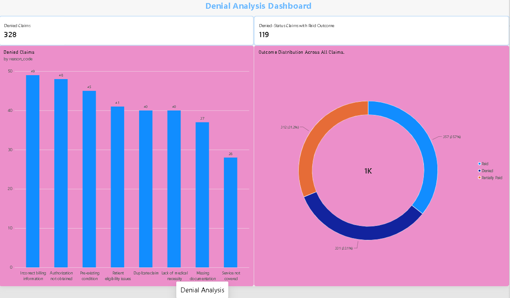

# Healthcare Claims Analysis

## Project Overview

This project analyzes healthcare insurance claims to understand claim status, financial performance, denial reasons, follow-up requirements, and data quality issues.

It demonstrates an end-to-end data analytics workflow using MongoDB, Python, MySQL, SQL, and Power BI.

## Power BI Dashboard




The interactive dashboard is saved in `powerbi/healthcare_claims_analysis.pbix`. It presents claim status, financial KPIs, denial reasons, and follow-up requirements from the cleaned dataset. Open it with Power BI Desktop (Windows).

## Business Problem

Healthcare claim data can contain denied claims, outstanding balances, follow-up requirements, and inconsistencies between claim status and payment outcomes. Analyzing these issues helps identify financial patterns and areas that may require further investigation.

## Project Objectives

- Analyze overall claim volume and claim status.
- Calculate billed, allowed, paid, and outstanding amounts.
- Identify common claim denial reasons.
- Analyze follow-up requirements and claim aging.
- Validate financial calculations and data quality.
- Present insights through SQL reports and an interactive Power BI dashboard.

## Tools and Technologies

- **MongoDB:** Source data storage
- **Python:** Data inspection, cleaning, validation, and exploratory data analysis
- **Pandas:** Data manipulation and analysis
- **MySQL:** Structured data storage
- **SQL:** KPI analysis, aggregations, financial reconciliation, and validation
- **Power BI:** Dashboard development and visualization
- **Git and GitHub:** Version control and portfolio management
- **VS Code:** Development environment

## Project Workflow

1. Load healthcare claims data from MongoDB.
2. Inspect the dataset using Python.
3. Clean and validate the claims data.
4. Export the cleaned dataset to CSV.
5. Import the complete dataset into MySQL.
6. Execute SQL queries to analyze claims and financial KPIs.
7. Build an interactive Power BI dashboard for reporting.

Data pipeline:

```
MongoDB → Python Data Cleaning → CSV → MySQL → SQL Analysis → Power BI
```

## Dataset Overview

The cleaned dataset contains 1,000 claim records and 17 columns.

Important fields include:

- `claim_id`
- `provider_id`
- `patient_id`
- `date_of_service`
- `billed_amount`
- `allowed_amount`
- `paid_amount`
- `insurance_type`
- `claim_status`
- `reason_code`
- `follow_up_required`
- `ar_status`
- `outcome`
- `outstanding_amount`
- `data_quality_flag`

The service dates range from May 1, 2024, to September 20, 2024.

**Data note:** [State here whether the dataset is synthetic/sample or real, and which data files are included in or excluded from this repository. Do not publish real patient-level or otherwise sensitive information.]

## SQL Analysis

The project includes 12 SQL scripts covering the following areas:

1. Overall claims summary
2. Claim status analysis
3. Financial summary
4. Denial analysis
5. Accounts receivable (A/R) analysis
6. Insurance type analysis
7. Follow-up analysis
8. Claim aging analysis
9. Claim consistency checks
10. Financial reconciliation
11. Follow-up summary
12. Final data validation

## Key Insights

### 1. Claim Status Distribution

| Claim Status | Claims | Percentage |
|---|---:|---:|
| Under Review | 338 | 33.8% |
| Paid | 334 | 33.4% |
| Denied | 328 | 32.8% |
| **Total** | **1,000** | **100%** |

The three claim-status categories have relatively similar volumes.

### 2. Financial Summary

| Metric | Amount |
|---|---:|
| Total Billed Amount | 297,191 |
| Total Allowed Amount | 223,112 |
| Total Paid Amount | 200,754 |
| Total Outstanding Amount | 22,358 |

The financial reconciliation check returned a difference of 0, confirming that the total outstanding amount matches the calculated difference between allowed and paid amounts in the dataset.

Currency units are not specified in the source data.

### 3. Insurance Type Distribution

| Insurance Type | Claims |
|---|---:|
| Commercial | 259 |
| Medicaid | 259 |
| Self-Pay | 249 |
| Medicare | 233 |
| **Total** | **1,000** |

Commercial and Medicaid each account for 25.9% of the claims.

### 4. Follow-up Requirements

- Follow-up required: 522 claims (52.2%)
- Follow-up not required: 478 claims (47.8%)

More than half of the claims are marked as requiring follow-up, making follow-up tracking an important area for further analysis.

### 5. Common Denial Reasons

| Denial Reason | Claims |
|---|---:|
| Incorrect billing information | 49 |
| Authorization not obtained | 48 |
| Pre-existing condition | 45 |
| Patient eligibility issues | 41 |
| Lack of medical necessity | 40 |
| Duplicate claim | 40 |
| Missing documentation | 37 |
| Service not covered | 28 |

Incorrect billing information and missing authorization are among the leading denial reasons in the dataset.

### 6. Data Quality Validation

The final validation checks reported:

- Total records: 1,000
- Unique claim IDs: 1,000
- Missing claim IDs: 0
- Missing service dates: 0
- Missing outstanding amounts: 0
- Financial reconciliation difference: 0

Some records show differences between `claim_status` and `outcome`. These inconsistencies were identified for further investigation rather than automatically corrected.

## Project Structure

```
healthcare-claims-analysis/
│
├── python/
│   ├── 01_inspect_data.py
│   ├── 02_data_cleaning.py
│   ├── 03_inspect_dates.py
│   ├── 04_eda.py
│   ├── 05_business_validation.py
│   ├── 06_status_investigation.py
│   └── 07_import_csv_to_mysql.py
│
├── mongodb_queries/
│   └── indexes.js
│
├── sql/
│   ├── 01_overall_claims_summary.sql
│   ├── 02_claim_status_analysis.sql
│   ├── 03_financial_summary.sql
│   ├── 04_denial_analysis.sql
│   ├── 05_ar_analysis.sql
│   ├── 06_insurance_analysis.sql
│   ├── 07_follow_up_analysis.sql
│   ├── 08_claim_aging_analysis.sql
│   ├── 09_claim_consistency.sql
│   ├── 10_financial_reconciliation.sql
│   ├── 11_follow_up_summary.sql
│   └── 12_final_data_validation.sql
│
├── powerbi/
│   └── healthcare_claims_analysis.pbix
│
├── screenshots/
├── data/
│   ├── raw/
│   └── processed/
├── .gitignore
└── README.md
```

## How to Run the Project

### 1. Clone the Repository

```bash
git clone https://github.com/abhishekbhagat685/healthcare-claims-analysis.git
cd healthcare-claims-analysis
```

### 2. Create a Virtual Environment

```bash
python -m venv .venv
```

Activate it in Windows PowerShell:

```powershell
.\.venv\Scripts\Activate.ps1
```

### 3. Install Dependencies

```bash
pip install pandas pymongo mysql-connector-python python-dotenv
```

### 4. Configure Environment Variables

Create a local `.env` file in the project root. Use the following template and replace the placeholder with your own local MySQL password.

```
MONGODB_URI=mongodb://localhost:27017
MONGODB_DATABASE=parul
MONGODB_COLLECTION=patients Record

MYSQL_HOST=localhost
MYSQL_PORT=3306
MYSQL_USER=root
MYSQL_PASSWORD=YOUR_MYSQL_PASSWORD
MYSQL_DATABASE=healthcare_claims_db
```

**Important:** Never upload `.env` or actual passwords to GitHub. Keep `.env` ignored by Git.

### 5. Run the Python Scripts

Run the scripts from the project root in numeric order. For example:

```bash
python python/01_inspect_data.py
python python/02_data_cleaning.py
```

Run the MySQL import script only after the cleaned CSV and MySQL configuration are ready:

```bash
python python/07_import_csv_to_mysql.py
```

### 6. Run the SQL Analysis

Open MySQL Workbench, connect to your local MySQL server, select the `healthcare_claims_db` database, and execute the SQL scripts in order.

The analysis table used in this project is:

```
healthcare_claims_vscode
```

### 7. Open the Power BI Dashboard

Open `powerbi/healthcare_claims_analysis.pbix` in Power BI Desktop, or view the dashboard images in the `screenshots` folder.

## Limitations

- The analysis is based on the available dataset and its recorded fields.
- Currency units are not specified in the source data.
- Claim status and payment outcome inconsistencies require business-rule clarification.
- Date-based claim aging uses the date of service and may not represent the actual accounts-receivable aging date.
- The findings describe the supplied dataset and should not be interpreted as conclusions about all healthcare claims.

## Future Improvements

- Publish the Power BI dashboard to Power BI Service.
- Add deeper denial trend and provider-level analysis.
- Investigate inconsistencies between claim status and payment outcome.
- Introduce additional data quality and reconciliation checks.
- Expand the analysis with validated claim-processing and A/R dates.

## Author

**Abhishek Kumar Bhagat**
B.Tech in Computer Science and Engineering, Parul University | 2023–2027

GitHub: [abhishekbhagat685](https://github.com/abhishekbhagat685)

## Disclaimer

This project is intended for educational and portfolio purposes. The analysis should not be used as a substitute for healthcare billing, insurance, or financial compliance advice.
